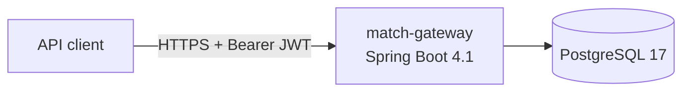

# Architecture

> From the architect subagent via /plan. Decisions with lasting impact go to docs/adr/.

## Overview

Packages: `com.vmartis.matchgateway.<feature>.{api,domain,infra}`; domain = pure Kotlin.

## Ambiguities & assumptions
| Id | Question / assumption | Impact | Default | Must-confirm |
|---|---|---|---|---|

## Data model
| Table | Column | Type | Constraints | PII/biometric? |
|---|---|---|---|---|

## API
| Method | Path | Request | Response | Errors | Role | Owner check |
|---|---|---|---|---|---|---|
| GET | /actuator/health | – | 200 `{"status":"UP"}` | – | public | – |

## Threat model (STRIDE-lite)
**Assets:**
**Trust boundaries:**

| Id | STRIDE | OWASP id | Threat | Mitigation | Plan step | Test |
|---|---|---|---|---|---|---|

## Evals approach
See docs/EVALS.md.
