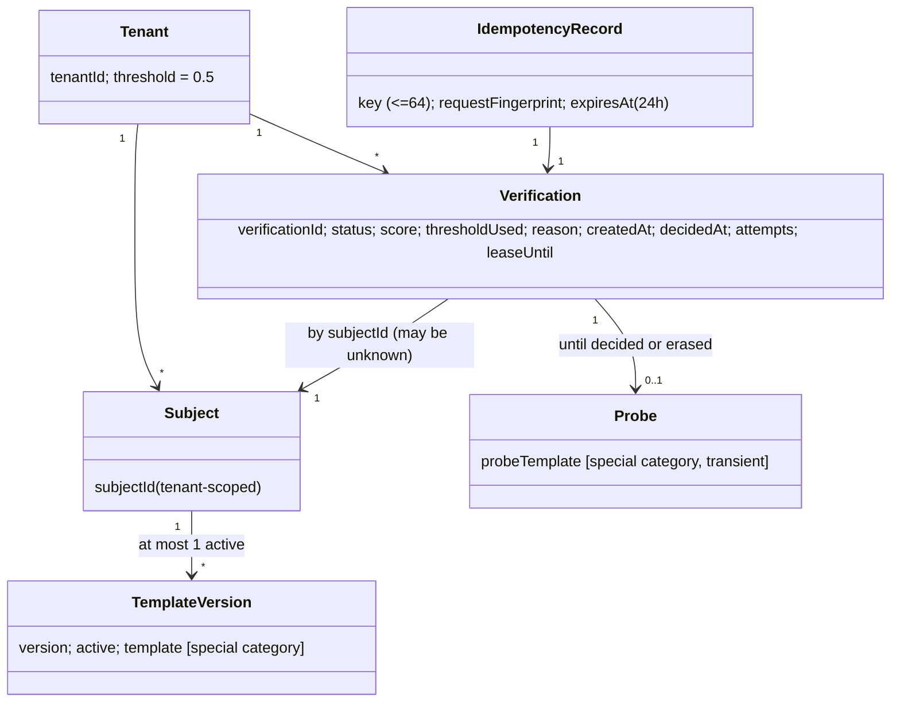
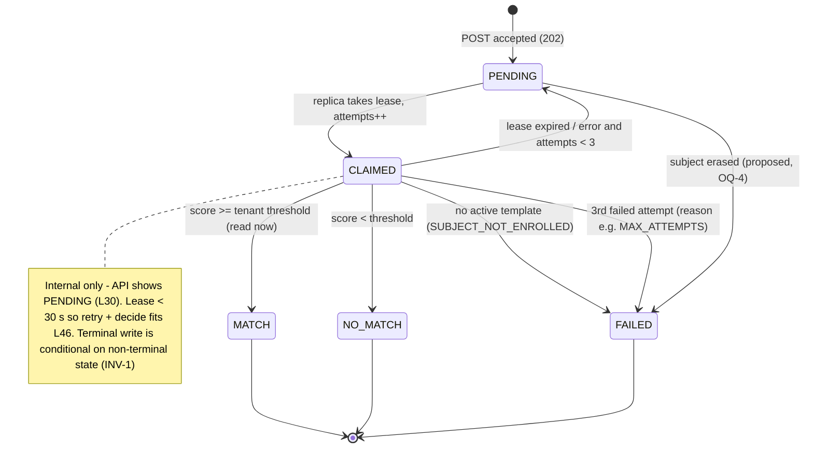

# Analysis

> LIGHT route [D-1]. Produced by the analyst subagent, written by the main session. Source: docs/ASSIGNMENT.md.
> Reuses TRIAGE.md questions Q1–Q5 and conflicts C-1..C-5 by id. Labels: `[A: "…"]` verbatim quote, `[D-x]` human decision,
> INFERRED (follows from cited sources), ASSUMPTION (guess; risk if wrong stated).

## 1. Problem statement

- **Who:** tenants – [A: "Our customers (banks and government agencies, called *tenants*) run our mobile SDK"]; [A: "Tenants enrol a template for each of their end users (*subjects*)."] [A: "Later they ask us to verify a fresh template (*probe*) against the enrolled one (1:1 verification)."]
- **Problem:** [A: "Traffic is bursty: at the start of business hours a large bank can send hundreds of verification requests per second for a few minutes."] [A: "Verification must not block the public API, and the system must scale horizontally."]
- **Why it matters:** data is [A: "Templates are biometric data (special category under GDPR)."]; tenants are regulated (INFERRED from "banks and government agencies"). A cross-tenant leak or a duplicate/conflicting decision is a compliance and trust failure (INFERRED). Unsolved: bursts block the API or yield inconsistent results, so tenants cannot rely on verification outcomes (INFERRED).
- **Business goal:** a multi-tenant, asynchronous 1:1 face-verification API that absorbs bursts, decides each verification exactly once and never exposes biometric data across tenants or in logs (INFERRED from L12–13, L36, L40, L45).

## 2. Actors and misuse cases

| Actor | Role |
|---|---|
| Tenant backend (scope `enroll` / `verify` / `admin`) | Machine caller; [A: "Required claims: `sub`, `tenant_id`, `scope`"] |
| Subject | Data subject; never calls the API (INFERRED: the only caller is the token holder) |
| Matcher replica | Internal worker; [A: "Runs as **3 replicas** in docker compose."] |
| Operator / evaluator | Runs compose, eval tool, load test (INFERRED from L64, L74) |
| Attacker: other tenant, outsider with a stolen token, malicious tenant client | See misuse cases |

| MC | Misuse case | Required / expected defence |
|---|---|---|
| MC-1 | Cross-tenant access: tenant B guesses/enumerates tenant A's verificationId or subjectId to read, verify against or delete | [A: "Use `404`, not `403`, for other tenants' resources."]; non-guessable ids (ASSUMPTION: random ids – if sequential, existence can be enumerated via timing/volume) |
| MC-2 | Token forgery/replay: `alg=none`, HS/RS key confusion, foreign issuer, expired token, stolen token replayed until `exp` | [A: "All endpoints except health require a **JWT bearer token** (RS256)."]; pinned algorithm, exp/iss/aud validation, short TTL (INFERRED from CLAUDE.md §4). Replay within TTL = accepted residual risk (ASSUMPTION) |
| MC-3 | Template exfiltration via logs/errors: validation error echoes the base64, stack trace/DB error with bound parameters, request-body logging | [A: "Template data and tokens must never appear in logs or error responses."] |
| MC-4 | Idempotency abuse: (a) reuse another tenant's key to obtain their verificationId; (b) flood unique keys to exhaust storage; (c) body probing via 422-vs-200 as an oracle | Key scoped per tenant (INFERRED from L23, L36); 24 h retention (L37); rate limit (L39); (c) reveals only the tenant's own data |
| MC-5 | DoS / burst / noisy neighbour: one tenant saturates gateway or queue so others miss NFR-2; oversized bodies; slow clients | [A: "Excess requests get `429` with `Retry-After`."]; body size limit (NFR-9); fair queueing across tenants = ASSUMPTION/Could |
| MC-6 | Malicious template payload: NaN/Inf, wrong length, non-base64 or URL-safe alphabet, unnormalised, nested/huge JSON | [A: "the template must decode to exactly 512 bytes, all values finite, L2 norm in `[0.99, 1.01]`"] → [A: "Otherwise return `400` (RFC 9457 problem detail)."] |
| MC-7 | Score oracle (hill-climbing): a `verify` holder iterates probes using the returned `score` to reconstruct the enrolled template or craft a "master" template | Brief requires `score` in GET (L30) → residual risk; rate limit (L39); production limitation (INFERRED) |
| MC-8 | Privileged in-tenant misuse: `enroll` client replaces a subject's template (account takeover); `admin` sets threshold 0.0 so everything matches | Allowed by the brief (L27, L31); audit trail = ASSUMPTION / production next step |

## 3. Key use cases

**UC-1 Enrol / replace (`enroll`)**
- **Main flow:**
  1. Client POSTs a template for a subjectId.
  2. JWT and scope are checked.
  3. The template is validated.
  4. A new version becomes active and the previous one inactive: [A: "Creates or replaces the subject's active template. Replacing keeps the previous version inactive."]
  5. 201 `{subjectId, version}`.
- **Alternative:** first enrolment → version 1 (ASSUMPTION).
- **Exceptions:** invalid template → 400; missing scope → 403 (C-5); invalid token → 401. Concurrent enrols of the same subject still leave exactly one active version (INV-2).

**UC-2 Request verification (`verify`)**
- **Main flow:**
  1. Client POSTs `{subjectId, probeTemplate}` with an Idempotency-Key.
  2. The probe is validated.
  3. The verification is persisted as PENDING.
  4. [A: "Returns `202` with `{"verificationId","status":"PENDING"}` and a `Location` header."]
- **Alternatives:**
  - (a) [A: "the same `Idempotency-Key` with the same body within 24 h returns the original `verificationId` (`200` or `202`)."]
  - (b) Unknown subject: [A: "accepted (`202`), then finishes with `FAILED` and `reason: SUBJECT_NOT_ENROLLED`."]
- **Exceptions:**
  - [A: "The same key with a different body returns `422`."]
  - Key missing or over 64 chars → 400 (INFERRED from [A: "Header `Idempotency-Key` (required, max 64 chars)."]).
  - Rate limit exceeded → 429 + Retry-After.
  - Concurrent first requests with the same key → exactly one verificationId (INV-6).

**UC-3 Get result (`verify`)**
- **Main flow:** [A: "Returns `{"verificationId","subjectId","status","score","threshold","decidedAt"}`."]
- **Alternative:** still PENDING → score, threshold and decidedAt are null (ASSUMPTION).
- **Exception:** unknown id or another tenant's id → 404.

**UC-4 Erase subject (`admin`)**
- **Main flow:** [A: "Right to erasure: removes all template versions of the subject and its verification probes."] [A: "Verification results stay, without template data."] 204.
- **Exception:** [A: "Returns `204`, or `404` if unknown."] An unknown subject, another tenant's subject and an already-erased subject all return 404 (INFERRED).
- **Race:** a verification of the subject is in flight (INV-5, OQ-4).

**UC-5 Set threshold (`admin`)**
- **Main flow:** [A: "Sets the tenant's decision threshold. Default `0.5`."] Returns 200 or 204 (ASSUMPTION).
- **Exception:** value outside 0.0–1.0, NaN or non-numeric → 400 (INFERRED from L31).

**UC-6 Process verification (matcher)**
- **Main flow:**
  1. A replica claims a PENDING job with a time-bounded lease.
  2. [A: "Consumes pending verifications, loads the subject's active template, computes **cosine similarity** (`score`)"]
  3. It reads the tenant threshold at this moment: [A: "decides `MATCH` if `score >= threshold` of the tenant at decision time."]
  4. It persists the decision and drops the probe.
- **Alternatives:**
  - No active template → FAILED/SUBJECT_NOT_ENROLLED, terminal, no retry (INFERRED).
  - Template replaced after the request → the version active at decision time is used (INFERRED from L44).
- **Exceptions:**
  - Replica crash: [A: "If a replica dies while holding a job, the job must be retried and decided within 30 s."] The lease expires and another replica claims the job.
  - Repeated failure: [A: "A job that fails 3 times ends as `FAILED` with a reason."]
  - A late "zombie" replica writes after its lease was taken over → the write is rejected (INV-1).

## 4. Domain glossary and model

| Term | Meaning |
|---|---|
| Template | [A: "a vector of 128 `float32` values, L2-normalised, sent as base64 (exactly 512 bytes before encoding, little-endian)."] |
| Template version | One enrolment of a subject; at most one active (L27) |
| Probe | Fresh template submitted for verification (L10); transient (BR-8) |
| Score | Cosine similarity of probe vs active template (L44) |
| Threshold | Per-tenant decision cut-off, default 0.5 (L31) |
| Lease / attempt | Time-bounded claim of a job by a worker; number of claims (INFERRED from L46–47) |
| FMR / FNMR | Share of impostor pairs decided MATCH / genuine pairs decided NO_MATCH (L76) |

**Invariants**
- **INV-1 Exactly-once outcome:** a verification transitions from non-terminal to terminal at most once; any later write (duplicate delivery, zombie replica, retry) is a no-op and cannot change status, score, threshold or decidedAt [A: "no duplicate or conflicting results even if a replica crashes mid-processing."].
- **INV-2 One active version:** per (tenant, subject) at most one active template version at any time; versions increase monotonically per subject (INFERRED from L27).
- **INV-3 Threshold at decision time:** read when deciding, not when the request arrives, and stored on the result as a snapshot (INFERRED from L30, L44).
- **INV-4 Tenant isolation:** every read/write/job carries the caller's tenant_id; the matcher only compares a probe with a template of the same tenant (INFERRED from L23, L36).
- **INV-5 Erasure:** after 204 no template version or probe of the subject exists; results stay without template data. An in-flight job for an erased subject cannot decide MATCH/NO_MATCH against erased data – proposed: FAILED (OQ-4) (INFERRED from L28).
- **INV-6 Idempotency scope:** key unique per (tenant, key) for 24 h; same key + same body → same verificationId; same key + different body → 422; never across tenants (INFERRED from L36–37).
- **INV-7 Attempts:** attempts ≤ 3; reaching 3 failed attempts → FAILED with reason. A lease expiry counts as an attempt, otherwise a poison job loops forever (ASSUMPTION).

## 5. Business rules and data inventory

| BR | Rule | Source |
|---|---|---|
| BR-1 | Every endpoint except health requires an RS256 JWT with sub, tenant_id, scope, exp; scope per endpoint | [A: "All endpoints except health require a **JWT bearer token** (RS256)."], L25–31, C-1 |
| BR-2 | Every operation is scoped to the caller's tenant; other tenants' resources → 404; missing scope → 403 | [A: "Every operation is scoped to the caller's `tenant_id`."], L36, C-5 |
| BR-3 | Template validity (512 bytes, finite, norm 0.99–1.01) else 400 problem detail – applies to enrolment and probe | L35; applying it to the probe is INFERRED ("the template" = any template field) |
| BR-4 | Enrolment creates a new active version; the previous one becomes inactive | L27 |
| BR-5 | Idempotency: required key ≤ 64 chars, 24 h window, same body → original id, different body → 422 | L29, L37 |
| BR-6 | Unknown subject → 202, then FAILED/SUBJECT_NOT_ENROLLED | L38 |
| BR-7 | MATCH iff score ≥ tenant threshold at decision time; default 0.5, range 0.0–1.0 | L31, L44 |
| BR-8 | The probe is kept only until the verification is decided | ASSUMPTION (TRIAGE Q4), from [A: "Store only what is needed; templates at rest should be encrypted (Should)."] |
| BR-9 | Erasure removes all versions and probes; results stay without template data | L28 |
| BR-10 | Per-tenant rate limit, default 300 req/s, configurable; 429 + Retry-After | L39 |
| BR-11 | A crashed job is retried and decided ≤ 30 s; after 3 failures FAILED with reason | L46–47 |
| BR-12 | Template data and tokens never appear in logs or error responses | L40 |

| Data item | Classification | Source | Retention |
|---|---|---|---|
| Enrolled template versions (active + inactive) | Special category – biometric | Tenant via enrol | Until erasure (L28); inactive versions kept indefinitely as the brief implies – pruning is ASSUMPTION/OQ-8 |
| Probe template | Special category – biometric | Tenant via verify | Until decided or erased (BR-8, ASSUMPTION) |
| Idempotency request fingerprint (derived from the probe) | Special-category derivative (INFERRED: a deterministic hash of a biometric is linkable) | Gateway | 24 h; also purged on erasure (ASSUMPTION); prefer a keyed hash |
| subjectId | PII (pseudonymous identifier) | Tenant | While results/templates exist (ASSUMPTION) |
| Verification result (status, score, threshold, decidedAt, reason) | PII – biometric-derived (score) | Matcher | Kept after erasure (L28); production retention period – OQ-8 |
| tenantId, JWT `sub`, threshold | Internal | Token / admin | Lifetime of the tenant |
| JWT / bearer token | Secret | Issuer | Never stored or logged (L40) |
| Logs, metrics (counts by result, queue depth, duration) | Internal, no PII/biometrics | Both apps | ASSUMPTION: 14 days |
| Dataset (`enrollments.jsonl`, `pairs.jsonl`) | Public (synthetic) | gen_dataset.py | Repo / eval run |

## 6. NFRs

| NFR | Requirement | Source |
|---|---|---|
| NFR-1 | [A: "Sustain **300 verifications/s for 60 s** on a developer laptop (docker compose, 3 matcher replicas), error rate < 0.1 %."] | Brief; conflicts with the 300 req/s per-tenant limiter (OQ-3) |
| NFR-2 | [A: "p95 time from `POST /v1/verifications` to final status ≤ **500 ms** under NFR-1 load."] | Brief; measurement method OQ-5 |
| NFR-3 | [A: "`POST /v1/verifications` p99 ≤ **100 ms** under NFR-1 load."] | Brief |
| NFR-4 | [A: "`/actuator/health` on both apps, plus metrics: verifications by result, queue depth or lag, processing duration."] | Brief; C-2 |
| NFR-5 | [A: "Templates are biometric data (special category under GDPR)."] [A: "Store only what is needed; templates at rest should be encrypted (Should)."] | Brief |
| NFR-6 | A job held by a crashed replica is decided ≤ 30 s after the crash | [A: "If a replica dies while holding a job, the job must be retried and decided within 30 s."] |
| NFR-7 | Exactly-once correctness: 0 duplicate/conflicting outcomes across ≥ 10 000 verifications with forced replica kills | ASSUMPTION (test target that makes L45 provable, L90) |
| NFR-8 | Score accuracy: equals a reference float64 cosine within 1e-5; MATCH/NO_MATCH flips allowed only within ±1e-6 of the threshold | ASSUMPTION |
| NFR-9 | Request body ≤ 8 KB (a template is ~684 base64 chars); larger → 413 | ASSUMPTION |
| NFR-10 | Token TTL ≤ 15 min, clock skew ≤ 60 s | ASSUMPTION (CLAUDE.md §4, not the brief) |
| NFR-11 | `docker compose up --build` reaches healthy ≤ 3 min on a laptop; no manual setup steps | ASSUMPTION (INFERRED from L4) |
| NFR-12 | Eval data volume: 1 000 subjects / 3 tenants, 5 000 pairs (L71–72); load test ≈ 18 000 verifications per run; design for 1–10 M rows without degrading NFR-2 | Eval volume from the brief; the 1–10 M row target is ASSUMPTION |

## 7. Solution options (decision level)

**(a) Gateway → matcher transport** – [A: "Justify it in an ADR, including how you guarantee the exactly-once outcome."]

| Option | Value | Effort | Risk |
|---|---|---|---|
| A1. PostgreSQL work queue (skip-locked claim + lease + attempts) | Job state, lease and result in one transactional store; exactly-once from a conditional terminal transition; no dual write from the gateway; no extra infrastructure | Low | Polling latency vs NFR-2 (short interval or wake-up signal); DB contention at 300/s × 3 replicas plausible but unproven on a laptop (ASSUMPTION) |
| A2. Redis Streams (consumer group, pending-entry reclaim) + PostgreSQL for results | Low latency; built-in reclaim of stuck messages | Medium | Dual write gateway → Redis + PostgreSQL needs an outbox or reconciliation; at-least-once delivery still needs a PostgreSQL conditional write; one more component |
| A3. RabbitMQ / Kafka | Industry-standard scaling | High | Same dual-write problem; heaviest ops; Kafka rebalances complicate the 30 s bound |

**Recommendation: A1** (= TRIAGE Q2). In every option the exactly-once guarantee rests on the conditional terminal write in PostgreSQL, so a broker only adds failure modes inside a 3 h box (INFERRED). The ADR records broker scale-out as the production next step.

**(b) Token issuance** – [A: "provide a way to obtain tokens"] [A: "(your own token endpoint or a dev script)"]

| Option | Value | Effort | Risk |
|---|---|---|---|
| B1. Dev-only token endpoint inside the gateway, behind a config flag | Easiest for the eval tool and k6 | Low | The gateway holds the private key and can mint any tenant's token; a flag leaked to production breaks tenant isolation; reviewers will flag it |
| B2. Dev script / CLI (on the host or as a one-shot compose service) that mints tokens with the private key | The gateway stays a pure resource server holding only the public key | Low–Medium | Key distribution must work out of the box without keys in the repo (keys generated at startup into a shared volume, ASSUMPTION) |
| B3. Separate dev issuer service (client-credentials style) | Cleanest separation; close to a real IdP | Medium | Third deployable to build and test |

**Recommendation: B2; fall back to B1 only under time pressure, off by default and documented as a limitation.** No user/password store (resolves C-4, TRIAGE Q3).

## 8. Assumptions and risks

| A | Assumption | Risk if wrong |
|---|---|---|
| A-1 | Callers are tenant backends; no end-user login exists | A user store would be needed (C-4) |
| A-2 | A lease expiry counts as one of the 3 attempts (INV-7) | Poison jobs loop forever, or healthy jobs fail too early |
| A-3 | Version numbering restarts at 1 after erasure | Clients caching the version may be confused |
| A-4 | Inside the gateway, PENDING covers both queued and claimed jobs | None – the brief lists only 4 statuses (L30) |
| A-5 | One gateway instance in compose, so an in-memory rate limiter is acceptable | Horizontal scaling (L13) would need a shared limiter – documented as a limitation |

| R | Risk | L / I | Mitigation |
|---|---|---|---|
| R-1 | Implementation overruns the 3 h box (TRIAGE risk 1) | H / H | Must-first backlog; walking skeleton |
| R-2 | NFR-1 unmeetable because of the limiter (OQ-3) or laptop CPU | M / M | Spread load across tenants or allow a burst; report honestly (L65) |
| R-3 | A zombie replica writes after its lease was taken over | M / H | Conditional terminal write; crash-recovery test (L90) |
| R-4 | Biometric data leaks into logs or problem details | M / H | No body logging; generic 400 messages; a test that greps logs for base64 |
| R-5 | Erasure races an in-flight job (decision against deleted data, or an orphaned probe) | M / H | INV-5 + a dedicated race test |
| R-6 | Default threshold 0.5 is wrong for this data (see eval notes) | H / M | Eval report recommends a threshold; tenants set it per tenant |

### Eval-data observations (INFERRED from dataset/gen_dataset.py – rough analytics, to be confirmed by the eval run)

- **Look-alikes:** ~2 % of subjects are look-alikes of the previous subject (`0.6*prev + 0.4*new`, base similarity ≈ 0.83 after normalisation). Hard-impostor probes come from the `idx+1` neighbour in 30 % of impostors → roughly 15 hard impostors out of ~2 500, expected scores ≈ 0.6, i.e. above the 0.5 default. Expect FMR at 0.5 to be well above 0.1 %.
- **Look-alikes sit in a different tenant:** tenants are assigned `i % 3`, so the look-alike neighbour always belongs to another tenant. The probe is still submitted against the subject's own tenant, so isolation is intact – worth stating in the report.
- **Poor-quality genuine captures:** 10 % of genuine probes use σ = 0.16 per component → expected scores ≈ 0.45–0.5, versus ≈ 0.74 for normal genuine probes (σ = 0.07). The default 0.5 already rejects many of them; a threshold for FMR ≤ 0.1 % (≈ 0.65–0.7) rejects almost all → FNMR floor ≈ 5 % of genuine probes.
- **Small sample for the FMR target:** FMR ≤ 0.1 % of ~2 500 impostors allows at most 2 errors – statistically weak (rule of three: 0 errors still gives a 95 % upper bound of ≈ 0.12 %). Report a confidence interval.
- **No unknown subjects:** every pair references an enrolled subject, so the eval does not exercise SUBJECT_NOT_ENROLLED. Subjects repeat across pairs, so the eval tool needs a unique Idempotency-Key per pair. It needs tokens for 3 tenants (`bank-alpha`, `bank-beta`, `gov-gamma`).
- **Noisy enrolments:** enrolled templates carry noise (σ = 0.03) rather than the clean base, so genuine scores are capped below 1.

## 9. Open questions (ranked by impact)

TRIAGE Q1 (Should cut), Q2 (transport, §7a), Q3 (tokens, §7b) and C-1..C-5 still stand; proposed defaults as in TRIAGE.md. New questions:

| # | Question | Impact | Proposed default |
|---|---|---|---|
| OQ-1 | = TRIAGE Q1 | Scope | As TRIAGE |
| OQ-2 | = TRIAGE Q2 / Q3 | Architecture | A1 + B2 (§7) |
| OQ-3 | NFR-1 load (300/s) equals the per-tenant limit (300 req/s), so 429s count as errors | Whether NFR-1 is met | Load test spread over 3 tenants; the limiter allows a short burst; documented |
| OQ-4 | Erasure while a verification is PENDING or claimed – what is the outcome? | Correctness, GDPR | Delete the probe; the job ends FAILED with reason SUBJECT_ERASED (or SUBJECT_NOT_ENROLLED); never MATCH/NO_MATCH after 204 |
| OQ-5 | How to measure NFR-2 "to final status" with a poll-only API? | Credibility of reported numbers | Primary: server-side `decidedAt − createdAt` histogram; cross-check: k6 polling |
| OQ-6 | GET response has no `reason` field, yet L38/L47 require one | API contract | Add an optional `reason` field, present only on FAILED |
| OQ-7 | Idempotent replay: 200 or 202? What counts as "same body"? | Contract, tests | 202 while PENDING, 200 once decided; fingerprint of the parsed (subjectId, probeTemplate), scoped per tenant |
| OQ-8 | Retention of results and inactive template versions? | GDPR minimisation (NFR-5) | Keep inactive versions (brief implies it); production retention stated as a limitation |
| OQ-9 | = TRIAGE Q4 (probe retention), Q5 (eval/load tooling), C-1..C-5 | Design | As TRIAGE |
| OQ-10 | subjectId format (length, charset) | Input hardening | ≤ 64 chars, `[A-Za-z0-9._-]`, otherwise 400 |
