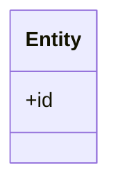
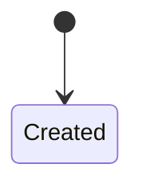

# Domain

> From the domain-expert subagent (FULL route). Regulatory/standards claims cite a source; unverified claims go to "Not sure".

## Glossary
| Term | Definition | Source |
|---|---|---|

## Domain model

## State machine

## Invariants
- 

## Corrections to ANALYSIS.md
| Location | What is wrong | Correct statement | Source |
|---|---|---|---|

## Added requirements
| BR-x / NFR-x | Requirement | Source | Rationale |
|---|---|---|---|

## Domain risks
| R-x | Risk | Likelihood | Impact | Mitigation |
|---|---|---|---|---|

## Metrics for evals
| Metric | Definition | How measured (dataset) | Target (source or ASSUMPTION) |
|---|---|---|---|

## Not sure
- 
